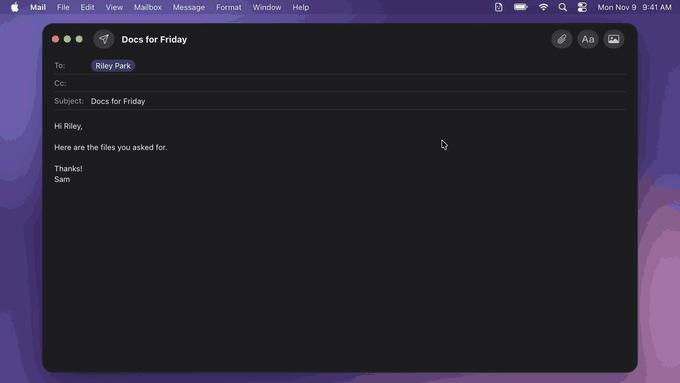

# Likely

Likely adds a search bar to every file picker. Describe what you need in plain English, and your agent finds it.
Website: [synth-inc.github.io/likely](https://synth-inc.github.io/likely/).

<p align="center">
  <a href="https://synth-inc.github.io/likely/"></a>
</p>

Likely is a menu bar app. When a file picker opens, it puts your most recently added files in `~/Likely`,
pinned to the sidebar (see Recent files below); most of the time, that's the one. Looking for something else?
Type it in plain English in the bar above the picker ("my 2025 W-2", "the logo with the transparent
background"). Your coding agent (Claude Code, Codex, Gemini CLI, OpenCode or Hermes, under your own account)
searches your Mac with Spotlight and read-only tools, and Likely clones the best matches into `~/Likely` in
place of the recent files. Not it? Say so, and it keeps looking. The agent runs only when you submit a search.
A file named `…<what the agent is doing>…` sits at the top of the folder as a live progress report.
The copies stay until the next picker opens (or 10 minutes after you close one), so apps that read the file later still find it.

**Recent files.** Often the file you want is the one you just downloaded, saved or screenshotted, so the
moment a picker opens Likely clones the 3 files with the newest Date Added in your search folders into the
folder, under a ` …Recent…` header (the leading space puts it on top by name; it's also newest by Date
Added). Folders, packages, hidden/sensitive paths, partial downloads, not-downloaded cloud files, files over
500 MB or on another volume, and dev/build folders (`node_modules`, `.build`, `DerivedData`, …) are skipped.
Files that came in one go (a copied folder, an unzipped archive) count once. Files apps write in the
background are left out: a file is kept if it was opened, is a screenshot or was downloaded, or else if it
arrived on its own, outside app and project folders (an Obsidian vault, a repo), and isn't still being
rewritten (`RecentSelector`, tested with `swift test`). The count (1–10) and an off switch are in Settings,
and `scripts/recent-files.sh [count] [-v]` prints what it would pick (`-v`: and why it skipped the rest). Settings → General → Jump to the Likely folder when a
Picker Opens (on by default) selects the folder in the picker's sidebar; when off, only once you search.

## Build & run

```sh
./build.sh            # → build/Likely.app (signed with your Apple Development identity)
open build/Likely.app
```

The setup window walks through Accessibility, creating `~/Likely` (drag it into
the Finder sidebar), and finding the `claude` CLI.

Encryption of your search history is off in builds without a provisioning profile. To turn it on
with your own Apple team, and for all build options, see [docs/BUILDING.md](docs/BUILDING.md).

For debugging, run the bare binary from a terminal (`.build/release/Likely`): it inherits the
terminal's Accessibility grant and logs to stderr.

## Releases & updates

Likely updates itself with [Sparkle](https://sparkle-project.org). The feed is `docs/appcast.xml` in
this repo, served by GitHub Pages at https://synth-inc.github.io/likely/appcast.xml (`SUFeedURL` in
Info.plist), so updates don't depend on the license server. Updates are signed with an EdDSA key kept in
the release machine's login Keychain (account `likely`).

```sh
scripts/bump-version.sh patch && git commit -am "Bump version"
# LIKELY_PROFILE must point at the Developer ID provisioning profile (docs/BUILDING.md)
scripts/release.sh --dry-run   # build, Developer ID sign, Likely.dmg, notarize, appcast → build/release
scripts/release.sh             # same, then tag vX.Y.Z, GitHub Release with Likely.dmg, and commit + push docs/appcast.xml
```

## How it works

- **Detection** (`AXWatcher`, `PickerHeuristics`): AX observers on every app. NSOpenPanel windows have
  `AXIdentifier` `open-panel` (Chrome: `AXSheetCreated`; TextEdit: `AXFocusedWindowChanged` /
  `AXWindowCreated`) and the sandboxed system dialog is `OpenPanel`. Button/browser heuristics are the fallback.
- **Close**: `AXUIElementDestroyed` on the panel, plus a poll for the panel's frame disappearing.
- **Context**: the app's name, the title of the window behind the picker and the picker's button title,
  all read through Accessibility. Likely takes no screenshots and doesn't need Screen Recording.
- **Recent files** (`RecentFiles`, `LikelyFolder.showRecent`): a synchronous `MDQuery` sorted by
  `kMDItemDateAdded` (last hour, then day, then 30 days), falling back to the top level of Desktop /
  Downloads / Documents; runs on its own queue, then clones on the Likely folder's copy queue. Copies are
  tagged with an xattr so ones made just before a crash are removed at the next launch.
- **Claude** (`ClaudeRunner`): `claude -p --output-format stream-json` with read-only tools
  (Read/Glob/Grep, `mdfind`, `ls`, …). Claude prints `STATUS:` / `FILE:` lines; the app does the copying
  (APFS clones), so Claude never writes anything. The other agents (`CodexRunner`, `GeminiRunner`, `OpenCodeRunner`,
  `HermesRunner`) follow the same protocol in their own read-only sandboxes. Agents start only when you submit a
  search; opening a picker only shows recent files.
- **Tools** (`ToolStore`, `Sources/LikelyTools`): extra command-line tools you give the agent (e.g. image
  search with rclip), kept in `~/Library/Application Support/Likely/tools.json` and edited in Settings →
  Tools or by a coding agent. Their commands are added to each agent's allowlist and their instructions to
  the prompt. See [docs/TOOLS.md](docs/TOOLS.md).

## Tools

Give the agent more ways to search: any command-line tool you have installed, plus instructions for when to
use it. For example, [rclip](https://github.com/yurijmikhalevich/rclip) finds photos by what's in them, so
"my headshot" works. Settings → Tools has a prompt to paste into your coding agent that installs a tool and
adds it to `~/Library/Application Support/Likely/tools.json`. Commands run unattended inside the agent's
read-only sandbox, and changes made outside Settings need your approval. See [docs/TOOLS.md](docs/TOOLS.md);
to check a tool helps, run your tests (below).

## Privacy

Likely doesn't run an AI. Searches go to
the AI provider you choose, through your own CLI and account, only when you submit one: your query and
follow-ups, the app name, window title and picker button, your name (on by default; Settings → Prompt), your Likely and search folder paths, the output of the agent's
searches and the contents of files it opens, your prompt, and your tools' instructions. The license server gets
a random install ID, records each request in PostHog (analytics: path, IP address, user agent, account number),
and stores the purchase details Stripe sends it (email, name, billing address, card brand, last 4 digits and
expiry). Checkout goes through Stripe. Your files, search history, eval cases and logs stay on your
Mac. Details:
[Privacy Policy](https://synth-inc.github.io/likely/privacy.html) ([source](docs/privacy.html)).

## Tests (evals)

Save searches as tests ("Save as test" in the bar above a picker, Settings → History → Make Eval, Settings →
Tests, or automatic saving of picks), then re-run them after adding a tool or editing the prompt to see
whether results improved: **Settings → Tests → Run Tests…**, or from the command line (your coding agent
can run it too):

```sh
/Applications/Likely.app/Contents/MacOS/Likely --eval personal --json
```

Turn on **Allow command-line test runs** in Settings → Tests first. It runs headlessly through the app's real prompt, agent runner and sandbox, writes `results.json` +
`report.html`, and compares with your previous run. Release builds run only your own tests, with agents
Likely detected; dev builds (`./build.sh`) also run the public suite (`--eval fixtures`, synthetic files in
`evals/fixtures`) and take developer options. Your tests live in
`~/Library/Application Support/Likely/evals/cases.jsonl`. See [docs/EVALS.md](docs/EVALS.md).

Logs: `~/Library/Logs/Likely/likely.log`. Release builds leave out queries, window titles, paths and agent text
unless Settings → General → "Log details for troubleshooting" is on (24 hours at most; it also logs every AX
event). Dev builds always log details. See docs/PRIVACY.md.

## Your data

Everything Likely keeps stays on this Mac, owner-only, unreadable to the search agents and out of Spotlight;
in official releases, search history is also encrypted (builds from source
need a provisioning profile for that: [docs/BUILDING.md](docs/BUILDING.md)). What's stored, where, and
how to delete it: [docs/PRIVACY.md](docs/PRIVACY.md).

## License

Likely is free software under the [GNU General Public License v3.0](LICENSE). The paid builds fund development;
if you'd rather build it yourself, `LIKELY_FREE=1 ./build.sh` skips the license step.

The paid license and services are covered by the [Terms of Service](https://synth-inc.github.io/likely/terms.html)
([source](docs/terms.html)); what Likely sends and where is in the
[Privacy Policy](https://synth-inc.github.io/likely/privacy.html) ([source](docs/privacy.html)).
